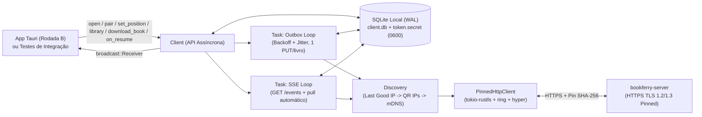

# MVP Fatia 2 (Rodada A) — Biblioteca Cliente de Sincronização (`bookferry-client`)

Data: 13/11/2026 · Ambiente: NixOS (`x86_64-linux`) via `spike/flake.nix` · Alvos verificados: `x86_64-unknown-linux-gnu` (testes de integração reais em processo) e `aarch64-linux-android` (`cargo check` via Android NDK 27.3.13750724).

> **Registro sobre `bookferry-core` e `bookferry-server`:** Nenhuma alteração foi necessária em `crates/bookferry-core` nem em `crates/bookferry-server`. A API e os contratos implementados na Fatia 1 atenderam integralmente a todos os fluxos de pareamento, pinning TLS, biblioteca, download com `Range` + `ETag`, sincronização HLC/LWW, histórico sem perda silenciosa e stream SSE.

---

## 1. Arquitetura do `bookferry-client`

A biblioteca `crates/bookferry-client` implementa o motor cliente de sincronização do Bookferry como código de produto (`#![forbid(unsafe_code)]`, sem estado global, sem caminhos absolutos fixos, sem `std::process::exit` e sem `unwrap`/`expect` em caminhos de rede ou banco), pronta para ser consumida pelos comandos Tauri v2 (Android e Desktop) na **Rodada B**.



### Estrutura de Módulos (`crates/bookferry-client/src/`)

| Arquivo | Responsabilidade |
|---|---|
| `lib.rs` | Fachada pública (`Client`, `ClientConfig`, `ClientEvent`, `PositionOrigin`, `DownloadReport`), pareamento/despareamento, download com `Range` e retomada atômica (`.part`), loops de background (SSE + Outbox) e controle de ciclo de vida (`on_resume`, `shutdown`). |
| `db.rs` | Persistência local em SQLite (`rusqlite` `bundled`, `WAL`, `PRAGMA user_version = 1`), relógio HLC monotônico persistente (`node = device_id`), cache da biblioteca, posições locais e por dispositivo, fila `outbox` coalescida por `book_id` e guarda do token (`0600`). |
| `tls.rs` | `PinnedServerCertVerifier` (`rustls` + `ring`, sem CAs do sistema), extração ASN.1 DER de `SubjectPublicKeyInfo` (SPKI), verificação criptográfica da assinatura do handshake TLS 1.2/1.3 e cliente HTTP/1.1 (`PinnedHttpClient`) sobre `tokio-rustls` + `hyper`. |
| `discovery.rs` | Ordenação determinística de candidatos de conexão (último IP bom → demais IPs do QR → mDNS `_bookferry._tcp.local.`), validação do TXT `fp` em tempo constante contra o pin salvo e trait `DiscoveryProvider` (com implementação real `MdnsSdDiscovery` e `MockDiscoveryProvider` para testes determinísticos sem multicast). |
| `resume.rs` | Lógica pura de decisão de retomada ao abrir um livro (`decide_resume`, `decide_resume_with_threshold`, `ResumeDecision`). |
| `error.rs` | `ClientError` e `ApiErrorBody`, classificação de falhas transitórias vs permanentes (`401 Unauthorized`, `422 hlc_too_far_in_future`) e redação de dados sensíveis. |

---

## 2. Schema SQLite Local (DDL — `PRAGMA user_version = 1`)

O banco fica em `<data_dir>/client.db` (permissão `0600` em sistemas Unix) com `journal_mode = WAL`, `synchronous = NORMAL` e `foreign_keys = ON`. O token Bearer também é espelhado em `<data_dir>/token.secret` com permissão `0600` escrita de forma atômica.

```sql
PRAGMA user_version = 1;

CREATE TABLE IF NOT EXISTS pairing (
    singleton       INTEGER PRIMARY KEY CHECK (singleton = 1),
    device_id       TEXT    NOT NULL,
    device_name     TEXT    NOT NULL,
    token_file      TEXT    NOT NULL,
    token_fallback  TEXT    NOT NULL,
    cert_sha256     TEXT    NOT NULL,
    spki_sha256     TEXT    NOT NULL DEFAULT '',
    last_good_ip    TEXT    NOT NULL,
    port            INTEGER NOT NULL,
    known_ips_json  TEXT    NOT NULL,
    paired_at_ms    INTEGER NOT NULL
) STRICT;

CREATE TABLE IF NOT EXISTS sync_meta (
    key   TEXT PRIMARY KEY,
    value TEXT NOT NULL
) STRICT;

CREATE TABLE IF NOT EXISTS cached_books (
    book_id         TEXT    PRIMARY KEY,
    sha256          TEXT    NOT NULL,
    title           TEXT    NOT NULL,
    authors_json    TEXT    NOT NULL,
    language        TEXT,
    publisher       TEXT,
    description     TEXT,
    size_bytes      INTEGER NOT NULL,
    mtime_ms        INTEGER NOT NULL,
    has_cover       INTEGER NOT NULL,
    updated_at_ms   INTEGER NOT NULL
) STRICT;

CREATE TABLE IF NOT EXISTS positions (
    book_id         TEXT    PRIMARY KEY,
    locator         TEXT    NOT NULL,
    percent         REAL    NOT NULL,
    snippet         TEXT,
    hlc             TEXT    NOT NULL,
    device_id       TEXT    NOT NULL,
    updated_at_ms   INTEGER NOT NULL
) STRICT;

CREATE TABLE IF NOT EXISTS device_positions (
    book_id         TEXT    NOT NULL,
    device_id       TEXT    NOT NULL,
    locator         TEXT    NOT NULL,
    percent         REAL    NOT NULL,
    snippet         TEXT,
    hlc             TEXT    NOT NULL,
    updated_at_ms   INTEGER NOT NULL,
    PRIMARY KEY (book_id, device_id)
) STRICT;

CREATE TABLE IF NOT EXISTS outbox (
    book_id         TEXT    PRIMARY KEY,
    locator         TEXT    NOT NULL,
    percent         REAL    NOT NULL,
    snippet         TEXT,
    hlc             TEXT    NOT NULL,
    attempts        INTEGER NOT NULL DEFAULT 0,
    last_error      TEXT,
    queued_at_ms    INTEGER NOT NULL
) STRICT;
```

### Chaves persistidas em `sync_meta`
- `hlc_state`: último `Hlc` emitido ou observado pelo cliente (garante monotonicidade estrita após reinício do app ou regressão do relógio físico).
- `hlc_clock_offset_ms`: ajuste de relógio em milissegundos aplicado quando o servidor rejeita um `PUT` com `422 hlc_too_far_in_future`.
- `last_seen_hlc`: maior HLC recebido do servidor via `GET /positions?since=` ou SSE (usado como cursor incremental do `pull()`).
- `last_sse_event_id`: último `id:` recebido no stream `GET /events` (enviado no cabeçalho `Last-Event-ID` ao reconectar).
- `library_cached_at_ms`: timestamp da última atualização bem-sucedida de `GET /books`.

---

## 3. API Pública (`crates/bookferry-client`)

```rust
pub struct ClientConfig {
    pub data_dir: PathBuf,
    pub device_name: String,
    pub connect_timeout: Duration,        // padrão: 2500 ms
    pub request_timeout: Duration,        // padrão: 10 s
    pub sse_read_timeout: Duration,       // padrão: 25 s (keepalive do servidor = 5 s)
    pub sse_backoff_initial: Duration,    // padrão: 400 ms
    pub sse_backoff_max: Duration,        // padrão: 10 s
    pub outbox_backoff_initial: Duration, // padrão: 250 ms
    pub outbox_backoff_max: Duration,     // padrão: 8 s
    pub mdns_timeout: Duration,           // padrão: 1200 ms
    pub resume_ask_threshold: f64,        // padrão: 0.02 (2 pontos percentuais)
    pub enable_mdns: bool,                // padrão: true
}

pub enum PositionOrigin {
    Local,
    RemoteSse,
    RemotePull,
    ServerConflictWinner,
}

pub enum ClientEvent {
    Connected { addr: SocketAddr },
    Disconnected { reason: String },
    Unpaired { reason: String },
    PositionChanged {
        book_id: String,
        position: PositionRecord,
        origin: PositionOrigin,
    },
    LibraryChanged,
    DownloadProgress {
        book_id: String,
        bytes: u64,
        total: Option<u64>,
    },
}

pub struct LibrarySnapshot {
    pub books: Vec<CachedBook>,
    pub stale: bool,
}

pub enum ResumeDecision {
    Nothing,
    UseLocal(PositionRecord),
    UseRemote(PositionRecord),
    Ask {
        remote: PositionRecord,
        local: PositionRecord,
    },
}

impl Client {
    pub async fn open(config: ClientConfig) -> Result<Self, ClientError>;
    pub fn with_discovery_provider(
        config: ClientConfig,
        discovery: Arc<dyn DiscoveryProvider>,
    ) -> Result<Self, ClientError>;
    pub fn with_custom_clock_and_discovery(
        config: ClientConfig,
        clock_ms: Arc<dyn Fn() -> u64 + Send + Sync>,
        discovery: Arc<dyn DiscoveryProvider>,
    ) -> Result<Self, ClientError>;

    pub fn subscribe(&self) -> broadcast::Receiver<ClientEvent>;
    pub fn is_paired(&self) -> Result<bool, ClientError>;
    pub fn paired_info(&self) -> Result<Option<PairedServerInfo>, ClientError>;

    // Pareamento (1 servidor por instalação)
    pub async fn pair_from_json(&self, qr_json: &str, device_name: Option<&str>) -> Result<PairedServerInfo, ClientError>;
    pub async fn pair(&self, payload: &PairingQrPayload, device_name: Option<&str>) -> Result<PairedServerInfo, ClientError>;
    pub async fn unpair(&self) -> Result<(), ClientError>;

    // Biblioteca e Downloads
    pub async fn library(&self) -> Result<LibrarySnapshot, ClientError>;
    pub async fn rescan(&self) -> Result<RescanResponse, ClientError>;
    pub fn local_path(&self, book_id: &str) -> Result<Option<PathBuf>, ClientError>;
    pub fn remove_download(&self, book_id: &str) -> Result<bool, ClientError>;
    pub async fn download_book<F>(&self, book_id: &str, cancel: Option<watch::Receiver<bool>>, on_progress: F) -> Result<DownloadReport, ClientError>
    where F: FnMut(DownloadProgress) + Send;

    // Posições, Outbox, Pull, Retomada e Ciclo de Vida
    pub async fn set_position(&self, book_id: &str, locator: &str, snippet: Option<String>, percent: f64) -> Result<PositionRecord, ClientError>;
    pub fn get_position(&self, book_id: &str) -> Result<Option<PositionRecord>, ClientError>;
    pub fn decide_book_resume(&self, book_id: &str, now_ms: u64) -> Result<ResumeDecision, ClientError>;
    pub fn outbox_len(&self) -> Result<usize, ClientError>;
    pub async fn flush_outbox(&self) -> Result<usize, ClientError>;
    pub async fn pull(&self) -> Result<usize, ClientError>;
    pub async fn on_resume(&self) -> Result<usize, ClientError>;
    pub async fn shutdown(&self);
}

pub fn decide_resume(local: Option<&PositionRecord>, remote: Option<&PositionRecord>, now_ms: u64) -> ResumeDecision;
pub fn decide_resume_with_threshold(local: Option<&PositionRecord>, remote: Option<&PositionRecord>, now_ms: u64, threshold: f64) -> ResumeDecision;
```

---

## 4. Máquina de Estados da Sincronização

```mermaid
stateDiagram-v2
    [*] --> Unpaired: Client::open (sem registro em pairing)
    [*] --> Connecting: Client::open (já pareado)
    Unpaired --> Connecting: pair() / pair_from_json() OK

    Connecting --> Connected: GET /events 200 OK\n(emite ClientEvent::Connected + executa pull() + acorda Outbox)
    Connecting --> BackoffWait: Falha de rede / timeout\n(emite ClientEvent::Disconnected se estava conectado)
    BackoffWait --> Connecting: Backoff 400ms..10s + jitter\nou sinal imediato de on_resume()

    Connected --> Connected: Evento SSE "position"\n(mescla por HLC, atualiza Last-Event-ID,\nemite PositionChanged se não for eco próprio)
    Connected --> Connected: set_position() -> grava SQLite + Outbox\n-> PUT /books/{id}/position
    Connected --> BackoffWait: EOF / erro de socket / read timeout (>25s sem keepalive)

    Connecting --> Unpaired: HTTP 401 Unauthorized\n(token revogado -> limpa banco/token -> emite ClientEvent::Unpaired)
    Connected --> Unpaired: HTTP 401 em PUT/pull/SSE ou chamada unpair()
```

---

## 5. Regras de Negócio e Segurança

### 5.1. Pareamento, Pinning TLS e Armazenamento de Segredo
1. **Um único servidor por instalação:** A tabela `pairing` possui restrição `singleton = 1`. Um novo `pair()` substitui o vínculo anterior. Isso simplifica o modelo de dados offline-first e reflete o caso de uso do MVP (um Calibre pessoal do usuário).
2. **Pinning TLS obrigatório (`PinnedServerCertVerifier`):**
   - Nunca confia em CAs do sistema operacional.
   - Rejeita inicialização se `cert_sha256` e `spki_sha256` estiverem vazios ou malformados (`ClientError::MissingTlsPin`).
   - Verifica em **tempo constante** (`bookferry_core::constant_time_eq_hex`) o SHA-256 do certificado folha DER (`cert_sha256`) e/ou o SHA-256 do `SubjectPublicKeyInfo` extraído da estrutura ASN.1 DER do certificado (`spki_sha256`).
   - Verifica criptograficamente a assinatura do handshake TLS 1.2/1.3 com `rustls::crypto::verify_tls12_signature` / `verify_tls13_signature` usando o provider `ring`.
3. **Por que não há Keystore nesta fatia (Rodada A) e o que o Android pedirá na Rodada B:**
   - Nesta Rodada A, `bookferry-client` roda como biblioteca pura Rust testada em processo no Linux sem runtime Android/JNI; por isso o token Bearer é persistido em `<data_dir>/token.secret` e `<data_dir>/client.db` com permissão de arquivo `0600` (`rw-------`).
   - Na **Rodada B (Tauri Android)**, além do sandbox por UID de aplicação do Android (`/data/data/<app_id>/`), o token Bearer (ou uma chave mestra que o cifra) será encapsulado via `AndroidKeyStore` (`AES/GCM/NoPadding` ou plugin Tauri de armazenamento seguro) antes de ser entregue ao `ClientConfig`.
4. **Despareamento (`unpair()`):** Se o servidor estiver alcançável, envia `DELETE /devices/{device_id}` autenticado; independentemente de falha de rede, limpa as tabelas locais (`pairing`, `outbox`, `sync_meta`) e remove `<data_dir>/token.secret`.

### 5.2. Localização do Servidor e Defesa contra Servidor Falso via mDNS
A resolução de candidatos segue estritamente a ordem:
1. **Último IP bom (`last_good_ip`)** persistido na tabela `pairing`.
2. **Demais IPs do payload QR (`known_ips_json`)**, sem duplicatas.
3. **Descoberta mDNS (`_bookferry._tcp.local.`)**:
   - Executada apenas se os IPs conhecidos falharem.
   - O registro TXT `fp` anunciado pelo serviço mDNS é comparado em tempo constante contra `cert_sha256` (ou `spki_sha256`) salvo no pareamento; candidatos com `fp` ausente ou divergente são **ignorados** antes mesmo de abrir socket TCP (impede sequestro por servidor falso na mesma LAN).
   - Mesmo após o mDNS sugerir um IP, a conexão HTTPS ainda exige o handshake TLS assinado pela chave privada correspondente ao pin.
   - Quando a conexão funciona em um novo IP (ex.: mudança por DHCP), `last_good_ip` e `port` são atualizados no SQLite.
   - Qualquer falha no daemon/socket mDNS é capturada e retorna lista vazia sem jamais derrubar o cliente.

### 5.3. Biblioteca e Downloads Resumíveis (`Range`)
- `library()` tenta `GET /books`: quando online, substitui a tabela `cached_books` em transação e retorna `LibrarySnapshot { books, stale: false }`; quando offline (erro transitório de rede), lê `cached_books` do SQLite e retorna `LibrarySnapshot { books, stale: true }`.
- `download_book(book_id, cancel, on_progress)`:
  - Sanitiza `book_id` com `bookferry_core::is_safe_id` (rejeita `..`, `/`, `\`, NUL ou caracteres fora de `[A-Za-z0-9_-]`), impedindo *path traversal* fora de `<data_dir>/books/`.
  - Grava os bytes em `<data_dir>/books/<book_id>.epub.part` e só renomeia atomicamente para `<book_id>.epub` após validar tamanho e SHA-256.
  - Se já existir um `.part` de uma tentativa interrompida, envia `Range: bytes=<offset>-` (e `If-Range: "<sha256>"` quando conhecido). Se o servidor responder `206 Partial Content`, faz `seek(SeekFrom::End(0))` e continua do byte exato sem rebaixar o início; se responder `200 OK`, recomeça do zero truncando o `.part`.
  - Faz streaming frame a frame (`BodyExt::frame()`) atualizando o `Sha256` incremental e gravando em disco sem carregar o livro inteiro na RAM.

### 5.4. Posição Offline-First, HLC Monotônico, Outbox, LWW e `on_resume`
- **HLC Monotônico Persistido:** Cada chamada a `set_position` carrega `hlc_state` de `sync_meta` dentro de uma transação SQLite `IMMEDIATE`, aplica `hlc_clock_offset_ms` ao relógio físico atual e chama `Hlc::tick(now_ms, &device_id)`. Mesmo que o app seja fechado e reaberto ou que o relógio do celular volte no tempo, o HLC emitido é estritamente maior que todos os anteriores.
- **Gravação Local Instantânea + Outbox Coalescida:** `set_position` atualiza `positions`, `device_positions` e faz `INSERT ... ON CONFLICT(book_id) DO UPDATE` na tabela `outbox`. Múltiplas mudanças de página offline no mesmo livro resultam em **um único `PUT /books/{id}/position`** com o estado mais recente quando a rede voltar.
- **LWW sem Perda Silenciosa (`applied = false`):**
  - Se o Dispositivo B escreveu offline (`t1`), o Dispositivo A escreveu depois (`t2 > t1`) e B reconectou: mesmo que o `pull()` de reconexão atualize a tabela `positions` de B com a posição vencedora de A (`t2`), a entrada `t1` da `outbox` de B **ainda é enviada via `PUT`** ao servidor.
  - O servidor responde `200 OK` com `applied = false` e `position = A(t2)` **e grava `B(t1)` em `position_history`**. Assim, nenhuma leitura feita offline se perde silenciosamente, e o cliente B remove o item da `outbox` e emite `ClientEvent::PositionChanged { origin: PositionOrigin::ServerConflictWinner }`.
- **Tratamento de Erros no Outbox Loop:**
  - `401 Unauthorized`: token do dispositivo foi revogado no servidor → limpa credenciais locais, emite `ClientEvent::Unpaired` e encerra o envio.
  - `422 Unprocessable Entity` (`hlc_too_far_in_future`): ajusta `hlc_clock_offset_ms`, re-emite um HLC válido para o item da `outbox` e reenvia imediatamente na mesma rodada.
  - `5xx` / timeout / sem rede: mantém na `outbox`, incrementa `attempts` e aguarda backoff exponencial (`250 ms` até `8 s`) com jitter determinístico.
- **Regra do Spike 03 (Android Doze e SSE):** O modo Doze do Android congela sockets TCP silenciosamente e eventos SSE podem ser perdidos antes da detecção de queda. Por isso:
  1. O cliente executa `pull()` (`GET /positions?since=<last_seen_hlc>`) **automaticamente em toda (re)conexão SSE**.
  2. O método público `Client::on_resume()` executa `pull()`, acorda o laço da `outbox` e força reconexão imediata do SSE se estiver em espera de backoff.
  3. O stream SSE aplica `tokio::time::timeout(sse_read_timeout = 25s)` em cada frame (o servidor envia `: keepalive` a cada 5s), detectando conexões meio-abertas.

### 5.5. Regra de Decisão de Retomada (`decide_resume`)
Função pura `decide_resume_with_threshold(local, remote, now_ms, threshold)` (limiar padrão `DEFAULT_RESUME_ASK_THRESHOLD = 0.02`, isto é, **2 pontos percentuais** na escala `0.0..=1.0`):
1. Sem posição local nem remota → `ResumeDecision::Nothing`.
2. Apenas posição local → `ResumeDecision::UseLocal(local)`.
3. Apenas posição remota → se for de outro `device_id` e `remote.percent > threshold`, retorna `ResumeDecision::Ask { remote, local: sintética 0% }`; caso contrário, `ResumeDecision::UseRemote(remote)`.
4. Ambas presentes:
   - Se `remote.device_id == local.device_id` ou `remote.hlc <= local.hlc` ou `remote.locator == local.locator` → `ResumeDecision::UseLocal(local)`.
   - Se `remote.hlc > local.hlc` (remoto mais novo de **outro** dispositivo):
     - Se `|remote.percent - local.percent| > threshold` → `ResumeDecision::Ask { remote, local }` (para a UI perguntar *"Continuar de onde parou no outro dispositivo?"*).
     - Se `|remote.percent - local.percent| <= threshold` → `ResumeDecision::UseRemote(remote)` (avanço pequeno, aplica direto sem interromper o leitor).

---

## 6. Decisões Técnicas, Justificativas (1 linha) e Licenças

### Escolhas Mainstream (Justificativa em 1 linha)
- **`tokio-rustls` + `rustls` (`ring`) + `hyper` + `hyper-util` (em vez de `reqwest`)**: Reutiliza exatamente a pilha HTTP/TLS já presente no `Cargo.lock` do workspace sem adicionar dependências extras, compila para `aarch64-linux-android` sem OpenSSL/CMake e dá controle direto sobre o `ServerCertVerifier` de pin SHA-256, streaming `Range` e timeouts por frame no SSE.
- **`rusqlite` (`bundled`)**: Embute a amalgamation SQLite em C compilada via NDK clang sem depender da versão de SQLite do Android do usuário e permite transações `IMMEDIATE` rápidas para o HLC e a `outbox`.
- **`mdns-sd`**: Implementação mDNS/DNS-SD em Rust puro sem dependência de Avahi/Bonjour do sistema operacional, compatível com Linux e Android.
- **`tokio`**: Runtime assíncrono padrão do ecossistema Rust, já utilizado em `bookferry-server` e no Tauri v2.

### Auditoria de Licenças (`cargo metadata --format-version 1`)
Total de pacotes no grafo do workspace: **187 crates**.
Nenhuma dependência possui licença `GPL` ou `AGPL` restritiva (`r-efi` é tri-licenciado `MIT OR Apache-2.0 OR LGPL-2.1-or-later`, sendo utilizado sob `MIT OR Apache-2.0`).

```text
Total packages: 187
Unique licenses: [
  '(MIT OR Apache-2.0) AND Unicode-3.0',
  'Apache-2.0',
  'Apache-2.0 / MIT',
  'Apache-2.0 AND ISC',
  'Apache-2.0 OR BSL-1.0',
  'Apache-2.0 OR ISC OR MIT',
  'Apache-2.0 OR MIT',
  'Apache-2.0 WITH LLVM-exception OR Apache-2.0 OR MIT',
  'Apache-2.0/MIT',
  'BSD-2-Clause OR Apache-2.0 OR MIT',
  'BSD-3-Clause',
  'ISC',
  'MIT',
  'MIT AND BSD-3-Clause',
  'MIT OR Apache-2.0',
  'MIT OR Apache-2.0 OR LGPL-2.1-or-later',
  'MIT OR BSD-3-Clause',
  'MIT/Apache-2.0',
  'Unlicense OR MIT'
]
```

---

## 7. Saídas Reais de Verificação e Métricas em Loopback

### 7.1. `cargo fmt --check` e `cargo clippy --workspace --all-targets -- -D warnings`

Comando executado:
```bash
cd spike && nix develop -c bash -c 'cd .. && cargo fmt --check && cargo clippy --workspace --all-targets -- -D warnings'
```

Saída real (exit code `0`, zero warnings):
```text
bookferry-spike devShell
  ANDROID_HOME=/nix/store/0pd1xvx1g9dfkqhxzd89hndyirv2mv3x-androidsdk/libexec/android-sdk
  NDK_HOME=/nix/store/0pd1xvx1g9dfkqhxzd89hndyirv2mv3x-androidsdk/libexec/android-sdk/ndk/27.3.13750724
  JAVA_HOME=/nix/store/avqpx52zv42hm3sssdbrhkcwf8ifha0z-openjdk-17.0.21.0.3+1/lib/openjdk
    Finished `dev` profile [unoptimized + debuginfo] target(s) in 0.25s
```

### 7.2. Compilação Cruzada Android (`cargo check --target aarch64-linux-android -p bookferry-client`)

Comando executado:
```bash
cd spike && nix develop -c bash -c '
  cd .. &&
  NDK_BIN="$NDK_HOME/toolchains/llvm/prebuilt/linux-x86_64/bin" \
  CC_aarch64_linux_android="$NDK_BIN/aarch64-linux-android24-clang" \
  AR_aarch64_linux_android="$NDK_BIN/llvm-ar" \
  CARGO_TARGET_AARCH64_LINUX_ANDROID_LINKER="$NDK_BIN/aarch64-linux-android24-clang" \
  cargo check --target aarch64-linux-android -p bookferry-client
'
```

Saída real (exit code `0`, sem OpenSSL/CMake):
```text
bookferry-spike devShell
  ANDROID_HOME=/nix/store/0pd1xvx1g9dfkqhxzd89hndyirv2mv3x-androidsdk/libexec/android-sdk
  NDK_HOME=/nix/store/0pd1xvx1g9dfkqhxzd89hndyirv2mv3x-androidsdk/libexec/android-sdk/ndk/27.3.13750724
  JAVA_HOME=/nix/store/avqpx52zv42hm3sssdbrhkcwf8ifha0z-openjdk-17.0.21.0.3+1/lib/openjdk
    Checking bookferry-client v0.1.0 (/home/gappy/Documents/projetos/bookshelf/crates/bookferry-client)
    Finished `dev` profile [unoptimized + debuginfo] target(s) in 1.07s
```

### 7.3. `cargo test --workspace -- --nocapture`

Comando executado:
```bash
cd spike && nix develop -c bash -c 'cd .. && cargo test --workspace -- --nocapture'
```

Saída real (exit code `0` — 29 testes ativos passando no workspace: 14 em `bookferry-client`, 8 em `bookferry-core`, 7 em `bookferry-server`):
```text
running 2 tests
test discovery::tests::candidate_ordering_and_pin_validation_unit ... ok
test resume::tests::resume_decision_covers_all_variants ... ok

test result: ok. 2 passed; 0 failed; 0 ignored; 0 measured; 0 filtered out; finished in 0.00s

     Running tests/integration.rs (target/debug/deps/integration-2a655e7f3a25f15a)

running 13 tests
test discovery_fallback_to_mdns_updates_saved_ip_and_ignores_fake_server ... ok
test download_complete_interrupted_range_resume_cancel_and_safe_path ... ok
test hlc_monotonic_persistence_across_reopen_clock_regression_and_422_future_adjustment ... ok
test library_online_offline_stale_and_rescan ... ok
test lww_conflict_offline_b_then_a_writes_then_b_reconnects_zero_data_loss ... ok
test mdns_live_discovery_with_real_server ... ignored, requires multicast UDP on local interface
test offline_set_position_queues_outbox_and_flushes_on_reconnect ... ok
test pairing_success_wrong_secret_reuse_wrong_pin_and_plain_http ... ok
test resume_decision_integration_with_client_db ... ok
[metric] sse_reconnect_and_pull_ms=85.225
test sse_reconnect_after_server_restart_on_same_port_recovers_missed_event_via_auto_pull_and_on_resume ... ok
test token_and_secret_never_appear_in_debug_or_tracing_logs ... ok
test token_revocation_401_emits_unpaired_and_stops_sync_loop ... ok
[metric] a_to_b_sse_latency_us=5780 (5.780 ms)
test two_clients_realtime_sse_a_writes_b_receives_under_1s ... ok

test result: ok. 12 passed; 0 failed; 1 ignored; 0 measured; 0 filtered out; finished in 0.45s

     Running unittests src/lib.rs (target/debug/deps/bookferry_core-31db844fa9d5a9f5)
running 8 tests
test result: ok. 8 passed; 0 failed; 0 ignored; 0 measured; 0 filtered out; finished in 0.01s

     Running unittests src/lib.rs (target/debug/deps/bookferry_server-14e55fb1ed469e72)
running 1 test
test result: ok. 1 passed; 0 failed; 0 ignored; 0 measured; 0 filtered out; finished in 0.09s

     Running tests/integration.rs (target/debug/deps/integration-40da45bd7cbbe451)
running 7 tests
test result: ok. 6 passed; 0 failed; 1 ignored; 0 measured; 0 filtered out; finished in 0.24s
```

### 7.4. Métricas Medidas em Loopback (`127.0.0.1`)

| Métrica | Valor Medido | Meta / Requisito |
|---|---|---|
| **Latência ponta a ponta `A -> Servidor -> SSE -> B`** (`set_position` em A até `ClientEvent::PositionChanged` em B) | **5,78 ms** (`5780 µs`) | `< 1000 ms` (`< 1 s`) |
| **Tempo de reconexão SSE + `pull()` automático após reinício do servidor na mesma porta** | **85,23 ms** | Backoff inicial configurável (100 ms em teste, 400 ms padrão) |
| **Tempo total da suíte de integração do `bookferry-client` (12 testes completos com TLS real)** | **450 ms** (`0.45 s`) | Sem sleeps longos fixos; polling curto + relógio injetável |

---

## 8. O que NÃO foi verificado nesta Rodada A e Itens para a Rodada B

### Não verificado na Rodada A (escopo planejado)
- **Multicast mDNS real em Wi-Fi doméstico entre dois aparelhos físicos:** a lógica de filtragem por TXT `fp`, ordenação de candidatos e atualização de IP por DHCP foi testada deterministicamente via `MockDiscoveryProvider`; o teste multicast real `mdns_live_discovery_with_real_server` fica marcado como `#[ignore]` para execução manual fora de ambientes com multicast restrito.
- **Execução em hardware Android real / ADB / Doze real do SO:** validamos a compilação cruzada `aarch64-linux-android` e o contrato `on_resume()` + reconexão SSE após queda do servidor, mas o ciclo de vida real `Activity.onResume()` será exercitado na Rodada B.
- **Integração com `AndroidKeyStore`:** nesta rodada o segredo usa permissão POSIX `0600` em `data_dir` (documentado na seção 5.1).

### Itens para a Rodada B (App Tauri Android + Desktop)
1. **Comandos e Eventos Tauri v2:** Encapsular `bookferry_client::Client` no `tauri::State`, encaminhando `ClientEvent` para o webview via `AppHandle::emit` e expondo comandos Tauri (`pair`, `unpair`, `library`, `download_book`, `set_position`, `get_position`, `decide_book_resume`, `on_resume`).
2. **Keystore Android:** Proteger o token Bearer usando `AndroidKeyStore` (ou plugin Tauri de armazenamento seguro) no Android, mantendo fallback `0600` no Linux desktop.
3. **Câmera / Leitor de QR Code:** Integrar leitura do QR de pareamento (`PairingQrPayload`) pela câmera no Android (e colagem de JSON como fallback no desktop/emulador).
4. **Leitor EPUB (`foliate-js`):** Embutir o leitor `foliate-js` offline nos assets do app, conectando eventos `relocate` (CFI + fração `percent` + `snippet`) a `Client::set_position` (com debounce) e exibindo o modal de `ResumeDecision::Ask` ao abrir um livro quando outro dispositivo estiver mais adiantado em mais de 2 pontos percentuais.
5. **Gatilho de Ciclo de Vida (`onResume`):** Conectar o evento de retorno ao primeiro plano do app Android/Tauri (`visibilitychange` / hook nativo `onResume`) a `Client::on_resume()`.


## Conferência do orquestrador (13/11/2026)

Refeita depois do agente:

- **Reexecutado:** `cargo test --workspace` (client: 12 de integração + 2 unitários + 1 ignorado de mDNS real; core 8; server 6 + 1 ignorado + 1 de permissão), `clippy -D warnings` e `fmt --check` limpos, `cargo check --target aarch64-linux-android -p bookferry-client` ok. A suíte de integração do cliente rodou **15 vezes seguidas sem falha** (nenhum flaky). O agente **não alterou** `bookferry-core` nem `bookferry-server` (só `Cargo.toml` e `Cargo.lock` da raiz).
- **Código de rede sem `unwrap`/`expect`** (os poucos que restam estão em módulos de teste) e `#![forbid(unsafe_code)]`.
- **Teste de mutação (quebrei o código de propósito):** pegos pelos testes: remover o pull automático após reconexão SSE; inverter o limiar do `Ask`; aceitar qualquer certificado no pin TLS; ignorar o `.part` na retomada do download. **NÃO pego:** a limpeza da outbox apagar também escritas locais mais novas que o PUT em voo (o usuário vira página enquanto o sync envia, e a posição nova nunca chegaria ao servidor). Acrescentei o teste `db::outbox_race_tests::completing_old_put_keeps_newer_local_write_in_outbox`; agora a mutação é pega.
- **Licenças:** 184 pacotes de registro. O único com copyleft na expressão é `r-efi` (`MIT OR Apache-2.0 OR LGPL-2.1-or-later`: usa-se MIT). Nenhum só-copyleft. O agente usou `hyper` + `tokio-rustls` (não `reqwest`). `cargo audit`/`deny` não rodaram.
- **Ressalvas que acrescento:**
  - `tls.rs` tem um **parser DER de X.509 escrito à mão** (`extract_spki_from_x509_der`) para extrair o SPKI do pin. Está no caminho de segurança; funciona nos testes (pin certo/errado/ausente), mas deveria ser trocado por crate madura (ex.: `x509-parser`, `rustls-webpki`) ou ganhar teste com certificados de formas variadas (RSA, cadeias, extensões). Pendência para antes do release.
  - Teste de mDNS real, Doze real, `Activity.onResume` e Keystore Android: **não verificados** (só na rodada B, com o celular).
  - O segredo/token fica em arquivo com `0600` no `data_dir`. No Android, `data_dir` do app é privado do app, mas não é Keystore.
  - As latências (5,78 ms A→B via SSE; 85 ms de reconexão) são em loopback; a medida real em rede é a do spike 03.
