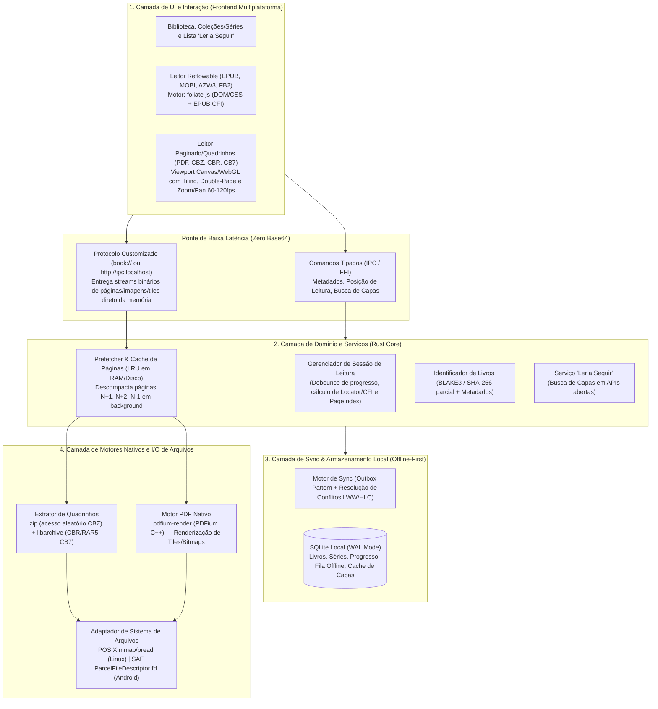

# FRENTE 2 — Stack de Cliente e Motores de Renderização

## 1. Contexto e Requisitos Arquiteturais do Cliente

O **Bookshelf** propõe unir duas referências de usabilidade em um único ecossistema sincronizado entre **PC (Linux/NixOS como plataforma principal, além de Windows/macOS)** e **Android**:
1. **Padrão Moon+ Reader (Leitura Reflowable):** renderização tipográfica avançada para **EPUB, MOBI, AZW3 (KF8) e FB2**, suporte a CSS editorial, temas customizados, notas de rodapé e precisão de posição independente de tamanho de tela via **EPUB CFI (Canonical Fragment Identifier)**.
2. **Padrão YACReader (Quadrinhos e Paginados):** leitura fluida de **CBZ, CBR, CB7, CBT e PDFs grandes** (100 MB a >2 GB), com abertura instantânea sem extração integral em disco, *double-page spreads*, *zoom/pan* a 60–120 fps e *prefetching* de páginas adjacentes em background.

O desafio central da escolha de stack reside numa assimetria técnica:
- **Formatos paginados (PDF/CBZ/CBR)** exigem acesso nativo a arquivos (*memory mapping*, *file descriptors*, decodificação C/C++/Rust de imagens e *tiling* em GPU).
- **Formatos reflowable (EPUB/AZW3/FB2)** são essencialmente documentos XHTML + CSS complexos. Tentar reimplementar um motor de layout HTML/CSS do zero em um canvas próprio (Skia/Impeller) resulta em quebras de layout, falta de suporte a tabelas/fórmulas/fontes embarcadas e incompatibilidade com EPUB 3. Por isso, os melhores leitores modernos (Foliate, Readest, Thorium, Readium, Apple Books) utilizam motores baseados em WebEngine/DOM para EPUB e motores nativos para arquivos binários e PDFs.

---

## 2. Comparação de Stacks de Cliente (PC Linux + Android)

### 2.1 Tabela Comparativa Geral

| Critério | Tauri v2 (Linux + Tauri Mobile Android) | Flutter (Linux GTK + Android) | Kotlin Multiplatform (Compose Multiplatform) | Electron (PC) + Capacitor (Android) | React Native |
| :--- | :--- | :--- | :--- | :--- | :--- |
| **Versão Estável Atual** | Tauri `2.x` (Core Rust + WebView nativo) | Flutter `3.47+` (Impeller padrão no desktop) | CMP `1.12.x` / Kotlin `2.1+` / `2.2` | Electron `34+` / Capacitor `6+` / `7+` | RN `0.76+` (New Architecture) |
| **Maturidade Desktop Linux** | **Alta.** Usa GTK3 + `webkit2gtk-4.1` (libsoup3). Pacotes nativos `.deb`, `.rpm`, AppImage e ótimo suporte no Nixpkgs. | **Alta.** Embedder GTK + motor **Impeller (Vulkan)** ativo por padrão desde a 3.47. Wayland nativo (com ressalvas em drivers NVIDIA). | **Média.** Baseado em Skiko (Skia) sobre AWT/Swing. Ainda depende de **XWayland** por padrão no Linux estável (Wayland nativo em evolução). | **Alta.** Chromium completo + Ozone/Wayland maduro. Contudo, alto consumo de RAM (>300 MB ocioso) e binários de ~200 MB+. | **Inexistente/Experimental.** Microsoft mantém apenas Windows e macOS; não há target Linux oficial. |
| **Desempenho PDFs e Quadrinhos** | **Alto (com backend Rust).** Extração/renderização pesada roda em Rust nativo e entrega buffers via protocolo customizado (`http://ipc.localhost`). | **Muito Alto.** `pdfrx` (PDFium via FFI) e texturas de GPU diretas no Impeller garantem *zoom/pan* excelente em PDF/CBZ. | **Alto.** Acesso direto a JNI/JVM no desktop e `Bitmap`/NDK no Android; excelente controle de threads via Coroutines. | **Médio-Alto.** Node.js permite addons nativos C++/Rust no PC, mas no Android (Capacitor) exige plugins Java/Kotlin separados. | **Baixo no PC Linux (inviável).** Bom no Android via JSI/C++, mas descartado pela ausência de Linux. |
| **Suporte a EPUB / Reflowable** | **Excelente.** Como a camada de UI já é um WebView moderno, roda **`foliate-js`** nativamente com zero gambiarra em ambas as plataformas. | **Fraco no Linux.** Não há WebView oficial de primeira classe no Flutter Linux (`flutter_inappwebview` usa WPE WebKit em beta). Parsers Dart puros quebram CSS complexo. | **Assimétrico.** No Android há o excelente `readium/kotlin-toolkit`, mas ele é **exclusivo Android** (não compila para JVM Desktop). | **Excelente.** Roda `foliate-js` diretamente no Chromium (Linux) e no Android System WebView (Capacitor). | **Médio.** Depende de `react-native-webview` no mobile; sem solução para Linux. |
| **Reuso de Código (Linux + Android)** | **~90–95%.** Único frontend (TS/React/Svelte/Solid) + único core nativo em **Rust** (SQLite, Sync, Archive, PDFium) compilado para Linux e Android NDK. | **~85–90%.** UI e lógica 100% em Dart (+ Rust opcional via `flutter_rust_bridge`). Perde reuso se precisar de WebView customizado no Linux. | **~75–80%.** UI (Compose) e domínio compartilhados, mas motores de leitura (Readium Android vs Desktop) exigem implementações separadas. | **~70–80%.** Frontend Web é 100% compartilhado, mas o backend nativo fica dividido entre Node.js (Electron) e Kotlin/Java (Capacitor). | **<50%** (exigiria outro app para Linux). |
| **Licença da Stack** | MIT / Apache-2.0 | BSD-3-Clause | Apache-2.0 | MIT | MIT |

### 2.2 Análise Detalhada por Stack

1. **Tauri v2 (Desktop Linux + Tauri Mobile Android):**
   - **Pontos fortes:** Resolve simultaneamente os dois mundos do Bookshelf. No frontend, executa **`foliate-js`** diretamente no WebView do sistema (`webkit2gtk-4.1` no Linux e Chromium System WebView no Android), entregando suporte imediato e fiel a EPUB, MOBI, AZW3 e FB2 com CFIs precisos. No backend, o processo **Rust** compila tanto para Linux quanto para Android (via JNI/NDK), permitindo usar `libarchive`, `pdfium-render` e `rusqlite` com performance nativa e baixo consumo de memória.
   - **Caso real validado:** O leitor open-source **Readest** (`readest/readest`) adota exatamente **Tauri v2 + Next.js/React + `foliate-js`**, provando que essa arquitetura funciona em produção no Linux, Windows, macOS, Android e iOS.
   - **Pontos de atenção:** Diferenças de motor entre `webkit2gtk-4.1` (WebKit no Linux) e Android WebView (Blink/Chromium); mitigável porque `foliate-js` foi originalmente escrito para o WebKitGTK (app Foliate de Linux) e testado intensivamente em Chromium.

2. **Flutter (Linux Desktop + Android):**
   - **Pontos fortes:** Melhor pipeline gráfico unificado para *canvas* 2D. Com o **Impeller (Vulkan)** ativo por padrão no Linux desde o Flutter 3.47 e a biblioteca **`pdfrx`** (`v2.12.0`), o desempenho em PDFs grandes e *zoom/pan* de quadrinhos (CBZ/CBR) é excepcional.
   - **Pontos de atenção (O "Gargalo do EPUB no Linux"):** Parsers EPUB escritos em Dart puro (`epub_view`, `epubx`) convertem HTML em widgets Flutter básicos, destruindo a formatação original de livros técnicos e literários. Já pacotes baseados em WebView (`flutter_epub_viewer`) dependem do `flutter_inappwebview`, cujo suporte a Linux (via WPE WebKit) ainda é experimental/beta e complexo de empacotar em distros variadas.

3. **Kotlin Multiplatform + Compose Multiplatform (CMP `1.12.x`):**
   - **Pontos fortes:** Ecossistema nativo no Android (acesso direto ao Storage Access Framework, `ParcelFileDescriptor` e `readium/kotlin-toolkit`).
   - **Pontos de atenção:** O **Readium Kotlin Toolkit (`v3.1.x` / `v3.4.0`) é acoplado ao SDK do Android** (`android.webkit.WebView`, `ContentResolver`), não funcionando no Compose Desktop (JVM). No Linux Desktop, você teria que embutir o JCEF (Java Chromium Embedded Framework, que adiciona >150 MB ao pacote) para renderizar EPUBs com qualidade equivalente, além de conviver com a dependência atual do AWT/XWayland.

4. **Electron + Capacitor:**
   - **Pontos fortes:** Elimina discrepâncias de WebView no desktop (traz Chromium embutido).
   - **Pontos de atenção:** Requer manter duas pontes nativas distintas para leitura de arquivos grandes (C++/Node.js no Electron vs Plugin Kotlin no Capacitor), além do alto custo de RAM e armazenamento no Linux/NixOS.

5. **React Native:**
   - **Descartado:** Ausência de suporte oficial ou maduro para Linux Desktop.

---

## 3. Motores de Renderização por Formato e Licenciamento

### 3.1 Tabela de Motores e Bibliotecas Reais/Mantidas

| Formato | Biblioteca / Motor | Versão / Status (2026) | Licença | Impacto na Distribuição a Terceiros | Avaliação Técnica para o Bookshelf |
| :--- | :--- | :--- | :--- | :--- | :--- |
| **PDF** | **PDFium** (`bblanchon/pdfium-binaries`, `pdfium-render` em Rust, `pdfrx` v2.12.0 no Flutter) | Ativo (Mantido pelo Google/Chromium; `pdfrx` v2.12.0 em nov/2026) | **BSD-3-Clause** (`pdfrx`: MIT; `pdfium-render`: MIT/Apache-2.0) | **Permissiva.** Permite distribuição comercial, código fechado ou open-source sem restrições copyleft. | **Escolha ideal para PDF pesado.** Renderização nativa C++ ultrarrápida, suporte a *tile rendering*, seleção de texto e baixo uso de RAM. |
| **PDF** | **PDF.js** (`mozilla/pdf.js` / `pdfjs-dist`) | Ativo (`v6.5.438`) | **Apache-2.0** | **Permissiva.** Sem restrições para distribuição a terceiros. | Excelente integração com `foliate-js` e WebViews, mas consome mais CPU/RAM que o PDFium em PDFs escaneados de >500 MB. |
| **PDF** | **MuPDF** (`Artifex`) | Ativo (`1.24+` / `1.25+`) | **AGPL-3.0** (ou Comercial paga) | **Crítico (Viral).** Exige abrir todo o código-fonte do app (e do servidor se usado em rede) sob AGPL-3.0, ou pagar licença cara à Artifex. | **Descartado por licença.** Apesar de muito rápido, o PDFium entrega performance similar sob licença BSD-3-Clause. |
| **PDF** | **Poppler** | Ativo | **GPL-2.0 / GPL-3.0** | **Restritivo (Copyleft forte).** Obriga que o cliente inteiro seja distribuído sob GPL. | Desnecessário frente ao PDFium. |
| **EPUB** | **`foliate-js`** (`johnfactotum/foliate-js`) | Ativo (Motor oficial do Foliate Linux e do Readest) | **MIT** (dependência `zip.js` sob BSD-3-Clause) | **Permissiva.** Livre para qualquer modelo de distribuição. | **Escolha ideal multiplataforma.** Puro ES Modules, suporta EPUB 2/3, layout fixo, RTL, temas CSS e gera/consome **EPUB CFI** padrão para sync. |
| **EPUB** | **Readium Kotlin Toolkit** (`readium/kotlin-toolkit`) | Ativo (`v3.1.2` / `v3.4.0`) | **BSD-3-Clause** | **Permissiva** (exceto módulo opcional de DRM LCP da EDRLab). | Padrão ouro no Android nativo, mas **não roda no Linux Desktop** (exclusivo Android). |
| **EPUB** | **`epub.js`** (`futurepress/epub.js`) | **Estagnado / Abandonado** | **BSD-2-Clause** | Permissiva. | **Evitar.** Sem manutenção ativa; problemas conhecidos de memória e paginação que motivaram a criação do `foliate-js`. |
| **CBZ / CBR / CB7 / CBT** | **`libarchive`** (`libarchive/libarchive`) | Ativo (`v3.8.11`) | **BSD-2-Clause** | **Permissiva.** Implementação *clean-room* de RAR/RAR5 sem a licença restritiva da RARLAB. | **Escolha ideal para arquivos de quadrinhos.** Lê `.cbz` (ZIP), `.cbr` (RAR v4 e **RAR5** desde a v3.4+), `.cb7` (7z) e `.cbt` (TAR) sob uma única API C/FFI. |
| **CBR (RAR)** | **UnRAR oficial** (`rarlab` / `libunrar`) | Ativo | **Licença Proprietária UnRAR** | **Restrição Legal / Lojas.** Proíbe usar o código para recriar o algoritmo RAR. Classificado como *non-free* no Debian/Fedora e problemático no F-Droid. | Evitar como dependência primária; usar **`libarchive`** (BSD-2-Clause), que já descomprime RAR4 e RAR5 de forma 100% livre. |
| **MOBI / AZW3 / FB2** | **`foliate-js`** (`mobi.js` + `fb2.js` internos) | Ativo | **MIT** | **Permissiva.** | **Escolha ideal.** Descompacta e renderiza MOBI, Kindle KF8/AZW3 e FB2/FB2.ZIP diretamente em JS sem conversão externa e mantendo o mesmo sistema de CFI! |
| **MOBI / AZW3** | **`libmobi`** (`bfabiszewski/libmobi`) | Estável / Manutenção leve | **LGPL-3.0-or-later** | **Copyleft Fraco (LGPL).** No Android/iOS (linkagem estática), exige fornecer meios de relinkagem ou abrir o código. | Útil apenas se não se usar `foliate-js`. Com `foliate-js`, torna-se redundante. |
| **Conversão Geral** | **Calibre (`ebook-convert`)** | Ativo (`7.x+` / `8.x`) | **GPL-3.0** | **Copyleft Forte** se embutido; inviável empacotar no Android. | Usar apenas como ferramenta externa opcional do usuário no Desktop, nunca embutido no cliente. |

---

## 4. Impacto de Licenças na Evolução do Projeto

Como o briefing prevê uso pessoal inicial com **possibilidade futura de abertura para outros usuários / distribuição a terceiros**, as regras de licenciamento devem ser blindadas desde o dia zero:

1. **A armadilha do AGPL-3.0 (MuPDF e código do Readest):**
   - O **MuPDF** exige licença comercial se o app não for AGPL-3.0.
   - O app **Readest** (`readest/readest`) é licenciado sob **AGPL-3.0**, mas o motor que ele utiliza por baixo — o **`foliate-js` (`johnfactotum/foliate-js`)** — é licenciado sob **MIT**. Portanto, o Bookshelf deve importar diretamente o **`foliate-js` (MIT)** e construir sua própria camada de UI/Tauri, mantendo o Bookshelf livre de contaminação AGPL.
2. **A armadilha da licença UnRAR em pacotes Linux e Android:**
   - Vincular `libunrar` da RARLAB impede a inclusão do pacote nos repositórios `main` do Debian/Ubuntu, Fedora e F-Droid (sendo relegado a `non-free`). Usar **`libarchive` (BSD-2-Clause)** para `.cbr` (incluindo RAR5) + crate `zip` (MIT) para acesso aleatório rápido em `.cbz` garante 100% de compatibilidade OSI.
3. **Combinação Recomendada (100% Permissiva — MIT / BSD / Apache-2.0):**
   - **Stack:** Tauri v2 (MIT/Apache-2.0) ou Flutter (BSD-3-Clause).
   - **PDF:** PDFium (BSD-3-Clause) + PDF.js (Apache-2.0).
   - **EPUB / MOBI / AZW3 / FB2:** `foliate-js` (MIT).
   - **CBZ / CBR / CB7 / CBT:** `libarchive` (BSD-2-Clause) + `zip` crate (MIT).

---

## 5. Arquitetura em Camadas do Cliente

Independentemente de a camada visual usar Tauri v2 ou Flutter, o núcleo de alto desempenho (I/O de arquivos pesados, indexação, banco local, hash de arquivos e sincronização) deve ser isolado em um **Core em Rust**, comunicado via protocolo binário local (no Tauri) ou FFI (`flutter_rust_bridge` no Flutter).

### Detalhamento das 5 Camadas:

1. **Camada de UI (Apresentação e Gestos):**
   - **Visão de Biblioteca e Coleções:** Grade virtualizada de capas com suporte a agrupamento por série/volume (essencial para quadrinhos, estilo YACReader) e aba "Ler a seguir".
   - **Viewport Reflowable:** Instância do `foliate-js` que recebe capítulos sob demanda e emite eventos `relocate` contendo o **EPUB CFI** exato (ex.: `epubcfi(/6/14!/4/2/10:42)`), porcentagem global e capítulo atual.
   - **Viewport Paginado (Quadrinhos/PDF):** Canvas acelerado por hardware com matriz de transformação 2D (escala, translação, inércia), suporte a *fit-to-width*, *fit-to-height*, *double-page spread* (com opção de capa isolada e leitura oriental RTL para mangás) e *deep zoom* via *tiling* (quando o zoom passa de 150%, solicita ao backend um *tile* de alta resolução da região visível em vez de re-renderizar a página inteira).
2. **Camada de Domínio (Rust Core):**
   - **Identificação Multi-dispositivo (Hashing Rápido):** Para saber que `Batman_01.cbz` no PC Linux é o mesmo arquivo que está no Android sem ler 1 GB inteiro na thread principal, calcula um **hash composto rápido** (tamanho do arquivo em bytes + hash BLAKE3 dos primeiros 64 KB, dos 64 KB centrais e dos últimos 64 KB onde fica o diretório central do ZIP/PDF), complementado pelo hash completo em background.
   - **Normalização de Posição (`ReadingLocator`):** Unifica a posição em uma estrutura agnóstica:
     - Para paginados: `{ book_hash, page_index, total_pages, zoom_mode, updated_at_hlc }`.
     - Para reflowables: `{ book_hash, cfi, progress_fraction, chapter_title, updated_at_hlc }`.
3. **Camada de Sincronização (Offline-First):**
   - Registra cada mudança de página/CFI instantaneamente no SQLite local (com *debounce* de 1–2s para rede) e insere na fila `sync_outbox`.
   - Ao fechar o livro (evento `visibilitychange` / `onPause` no Android ou fechamento de janela no Linux), dispara um *beacon/flush* imediato (<50 ms) para o servidor de sync.
   - Em caso de conflito offline (leu no avião no Android e abriu no PC antes de sincronizar), compara o timestamp lógico (**HLC — Hybrid Logical Clock**) e, se divergirem significativamente, exibe um *toast* não intrusivo (*"Dispositivo Android parou na pág. 84 há 10 min. Ir para pág. 84?"*, exatamente como o Moon+ Reader).
4. **Camada de Armazenamento Local:**
   - **SQLite em modo WAL (`rusqlite` / `sqlx`):** Armazena catálogo local, metadados extraídos (`ComicInfo.xml` de CBZs, OPF de EPUBs), histórico de sessões, fila de sync e lista "Ler a seguir".
   - **Cache de Miniaturas e Páginas:** Diretório gerenciado em disco para capas WebP otimizadas e *buffer* em RAM (LRU de ~5 páginas: `N-1`, `N`, `N+1`, `N+2`, `N+3`) para transição de página com latência zero.
5. **Camada de Renderers e Abstração de I/O:**
   - **Protocolo `book://` (Zero Serialização JSON):** No Tauri v2, nunca se deve trafegar imagens de quadrinhos ou páginas de PDF em JSON/Base64 via IPC tradicional. Usa-se `register_uri_scheme_protocol("book", ...)` para que o componente de imagem/canvas peça `http://book.localhost/{book_id}/page/50?width=1920` e receba os bytes `image/webp` ou `image/jpeg` diretamente da memória do Rust.

---

## 6. Recomendação

### Recomendação Principal: **Tauri v2 (Linux + Android) + Core em Rust + `foliate-js` + `PDFium` + `libarchive`**

Para os requisitos específicos do **Bookshelf** (Linux/NixOS como cidadão de primeira classe + Android + suporte simultâneo a EPUB/MOBI/AZW3/FB2 estilo Moon+ Reader e PDF/CBZ/CBR estilo YACReader), **Tauri v2 com backend compartilhado em Rust** é a arquitetura de melhor custo-benefício e menor risco funcional.

**Justificativa objetiva:**
1. **Resolve 4 formatos complexos de texto de uma só vez (`foliate-js`):** Enquanto em Flutter ou KMP você precisaria integrar e manter motores díspares e incompletos no Linux para EPUB, MOBI, AZW3 e FB2, no Tauri v2 o `foliate-js` (MIT) resolve todos eles com suporte nativo a **EPUB CFI**, paginação por colunas CSS, notas de rodapé e dicionários, funcionando de forma idêntica no Linux (`webkit2gtk-4.1`) e no Android (System WebView).
2. **Performance nativa onde importa (Rust Core para PDF e Quadrinhos):** Todo o trabalho pesado de CPU e I/O — abrir um CBZ/CBR de 1,5 GB sem descomprimir tudo (`zip` / `libarchive`), renderizar páginas de PDFs pesados em paralelo (`pdfium-render`), calcular hashes BLAKE3 e gerenciar o SQLite — roda em **Rust nativo** compilado tanto para Linux x86_64/ARM64 quanto para Android NDK.
3. **Referência de mercado comprovada:** A arquitetura Tauri v2 + `foliate-js` já foi validada em produção pelo leitor multiplataforma **Readest**, eliminando a incerteza sobre se o Tauri Mobile aguenta um leitor de livros completo.
4. **Cidadão de primeira classe no Linux/NixOS:** Binários pequenos (~10–15 MB), consumo de memória muito inferior ao Electron e empacotamento limpo via Cargo + `webkit2gtk_4_1` no NixOS.

> **Alternativa Viável (Plano B): Flutter (`3.47+`) + `pdfrx` + Rust FFI (`flutter_rust_bridge`)**
> Caso a prioridade absoluta do usuário seja a experiência gráfica de quadrinhos/PDF em canvas puro (Impeller/Vulkan) acima da fidelidade tipográfica de EPUB/MOBI no Linux, **Flutter** é a segunda melhor opção. Nesse cenário, usa-se `pdfrx` (PDFium) para PDF, widgets nativos Flutter (`InteractiveViewer` customizado) para CBZ/CBR, e aceita-se o trade-off de embutir um WebView no Android (`flutter_inappwebview` + `foliate-js`) enquanto no Linux utiliza-se o suporte beta a WPE WebKit ou um servidor local leve.

---

## 7. Riscos Técnicos e Perguntas em Aberto

### 7.1 Riscos Técnicos Mapeados e Mitigações

| Risco Técnico | Severidade | Causa Raiz | Estratégia de Mitigação |
| :--- | :--- | :--- | :--- |
| **1. Lentidão ao ler pastas de quadrinhos no Android (SAF)** | **Alta** | O *Storage Access Framework* (`content://`) do Android não fornece caminhos POSIX (`/sdcard/...`) para bibliotecas C/C++/Rust (`libarchive`, `PDFium`), e iterar pastas via `ContentResolver` em Java é lento. | No Kotlin (plugin Tauri Android), usar `contentResolver.openFileDescriptor(uri, "r")`, extrair o descritor inteiro (`parcelFileDescriptor.fd` / `detachFd()`) e passá-lo via JNI para o Rust/C++. No nível nativo, usar `fdopen(fd, "rb")`, `pread` e `mmap` diretamente sobre o `fd`. Indexar metadados em background e cachear no SQLite. |
| **2. Engasgos em arquivos `.cbr` (RAR solid archives)** | **Média-Alta** | Diferente do `.cbz` (ZIP), que possui um índice central permitindo acesso aleatório instantâneo à página 150, arquivos `.cbr` criados como *Solid RAR* exigem descompressão sequencial desde o início do bloco. | Ao abrir um `.cbr` sólido no `libarchive`, manter o *stream* aberto e descomprimir as páginas em um diretório de cache temporário (disco/RAM) em uma thread worker em background enquanto o usuário lê as primeiras páginas, ou oferecer conversão automática transparente para `.cbz` no PC. |
| **3. Performance de *Zoom/Pan* a 60–120 fps em páginas 4K+ e PDFs** | **Média** | Decodificar uma imagem de 4000×6000 px na thread de UI ou re-renderizar o PDF a cada frame de *pinch-to-zoom* causa queda de frames (*jank*). | Aplicar transformação matricial CSS/WebGL (`transform: translate3d(...) scale(...)` com `will-change: transform`) durante o gesto ativo de *pinch/pan* usando a textura atual, e só solicitar um novo *tile* de alta resolução ao `PDFium` quando o gesto estabilizar (*debounce* de 150 ms). Decodificar imagens fora da thread principal (`createImageBitmap` / Rust image decoder). |
| **4. Quirks do `webkit2gtk-4.1` no Linux / Wayland / NVIDIA** | **Média** | Em sessões Wayland com GPUs NVIDIA ou compositores específicos (Sway/Hyprland/GNOME), o DMABUF renderer do WebKitGTK pode apresentar tela branca ou *flickering*. | Configurar variáveis de fallback conhecidas no wrapper de inicialização Linux (ex.: detectar falha de DMABUF e aplicar `WEBKIT_DISABLE_DMABUF_RENDERER=1` se necessário) e manter compatibilidade com empacotamento NixOS/Flatpak. |
| **5. Estouro de Memória (OOM) em Quadrinhos Webtoon / Long-Strip** | **Média** | Quadrinhos verticais contínuos (*webtoons*) possuem dezenas de imagens muito longas; manter todas no DOM/VRAM estoura a memória no Android. | Implementar reciclagem estrita de viewport (*virtualized list*): manter apenas as páginas visíveis + 2 páginas de margem na GPU, substituindo páginas distantes por *placeholders* com a altura exata pré-calculada no cabeçalho da imagem. |

### 7.2 Perguntas em Aberto para Decisão do Produto
1. **Sincronização de arquivos vs. apenas metadados/progresso:** O cliente assumirá que o usuário já copiou os arquivos (via Syncthing, SMB ou cabo) para o PC e Android (sincronizando apenas progresso via hash BLAKE3 + lista "Ler a seguir"), ou o app também deve baixar sob demanda os livros a partir do servidor self-hosted (estilo OPDS / Komga / Kavita)?
2. **Padrão de leitura vertical (Webtoon/Mangá):** Além da leitura paginada tradicional e *double-page spread* do YACReader, o modo de rolagem vertical contínua (*webtoon*) entra no escopo do MVP?
3. **Anotações e Destaques (Highlights):** No MVP, a sincronização de leitura cobrirá apenas a posição atual (`CFI` / `page_index`) ou também grifos/notas feitos dentro de EPUBs e PDFs?

---

## 8. Fontes

1. **Tauri v2 (Arquitetura, Linux WebKitGTK 4.1 e Mobile Android):**
   - Documentação oficial e pré-requisitos Linux/Android: <https://v2.tauri.app/start/prerequisites/>
   - Repositório oficial (MIT / Apache-2.0): <https://github.com/tauri-apps/tauri>
2. **`foliate-js` e Estudo de Caso Readest:**
   - `johnfactotum/foliate-js` (Suporte a EPUB, MOBI, KF8/AZW3, FB2, CBZ — Licença MIT): <https://github.com/johnfactotum/foliate-js>
   - `readest/readest` (Leitor multiplataforma em Tauri v2 + `foliate-js` — Licença AGPL-3.0): <https://github.com/readest/readest>
3. **Flutter Desktop Linux (Impeller/Vulkan) e `pdfrx`:**
   - Pacote `pdfrx` no pub.dev (`v2.12.0`, baseado em PDFium — Licença MIT): <https://pub.dev/packages/pdfrx> e <https://github.com/espresso3389/pdfrx>
   - `flutter_inappwebview` (Status suporte Linux WPE WebKit): <https://pub.dev/packages/flutter_inappwebview>
4. **Kotlin Multiplatform / Compose Multiplatform e Readium:**
   - Releases do Compose Multiplatform (`v1.12.x` / Skiko Linux): <https://github.com/JetBrains/compose-multiplatform/releases>
   - Readium Kotlin Toolkit (`v3.1.x` / `v3.4.0` — Licença BSD-3-Clause): <https://github.com/readium/kotlin-toolkit>
5. **Motores de PDF e Licenciamento:**
   - PDFium (Google/Chromium — Licença BSD-3-Clause): <https://pdfium.googlesource.com/pdfium/> e binários pré-compilados em <https://github.com/bblanchon/pdfium-binaries>
   - Crate Rust `pdfium-render` (MIT / Apache-2.0): <https://crates.io/crates/pdfium-render>
   - Mozilla `PDF.js` / `pdfjs-dist` (`v6.5.x` — Licença Apache-2.0): <https://github.com/mozilla/pdf.js> e <https://www.npmjs.com/package/pdfjs-dist>
   - MuPDF Licensing (AGPL-3.0 / Comercial — Artifex): <https://mupdf.com/licensing>
6. **Arquivos de Quadrinhos (CBZ/CBR/CB7) e MOBI:**
   - `libarchive` (`v3.8.11`, suporte a ZIP, 7z e RAR5 clean-room — Licença BSD-2-Clause): <https://github.com/libarchive/libarchive>
   - `bfabiszewski/libmobi` (Licença LGPL-3.0-or-later): <https://github.com/bfabiszewski/libmobi>
7. **React Native Desktop Support:**
   - Documentação de plataformas suportadas e out-of-tree (ausência de Linux oficial): <https://reactnative.dev/docs/out-of-tree-platforms>
8. **Android Storage Access Framework (SAF) e Descritores Nativos:**
   - Documentação oficial do Android `ContentResolver.openFileDescriptor` e `ParcelFileDescriptor`: <https://developer.android.com/training/data-storage/shared/documents-files>
